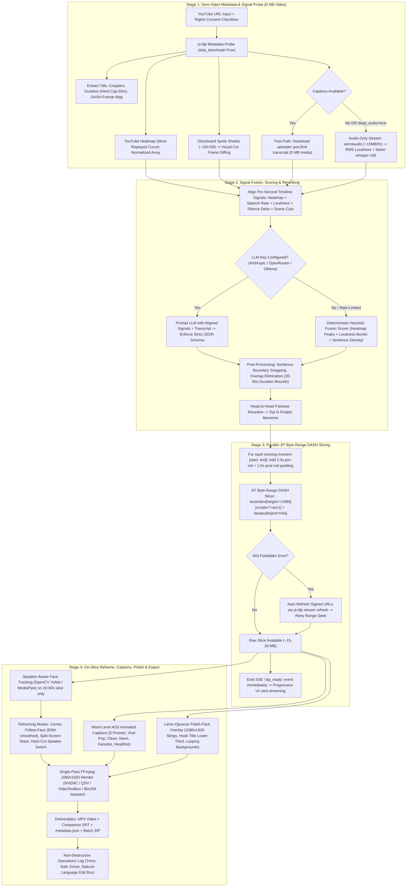

# PLAN.md: Architecture Blueprint & Implementation Specification
## ClipGlass Stream-Slice Auto Clip Engine (Three-Reference Synthesis)

---

### 1. Zero-Full-Download Pipeline Architecture

The primary differentiator of ClipGlass is that **the backend never downloads the entire long-form YouTube video**. The engine operates across four sequential stages:



---

### 2. Module Boundaries & Directory Layout

To maintain zero interference with existing ClipGlass features (downloader, studio, trimmer, sweeper), all new functionality is encapsulated in `apps/api/engine/` and exposed via `/api/clip/...` routes:

```
apps/api/
├── engine/                               # NEW: Pure Python modular Auto Clip Engine
│   ├── __init__.py
│   ├── probe/                            # Stage 1: Zero-video inspection
│   │   ├── __init__.py
│   │   ├── metadata_probe.py             # yt-dlp metadata-only probe & duration cap enforcement
│   │   ├── heatmap_extractor.py          # YouTube Most-Replayed curve extraction & normalization
│   │   ├── storyboard_diff.py            # Download storyboard sprite sheets (~100KB) & compute visual scene diffs
│   │   └── transcript_extractor.py       # json3/vtt transcript parser with noise tag filter ([Music]/[Applause])
│   ├── signals/                          # Stage 2: Signal alignment & acoustic energy
│   │   ├── __init__.py
│   │   ├── timeline_aligner.py           # Per-second continuous normalized signal grid
│   │   ├── acoustic_energy.py            # RMS loudness spike & silence-to-burst delta calculator (lowest-bitrate audio)
│   │   └── whisper_transcriber.py        # faster-whisper (CPU int8 / CUDA auto-detect) word-timestamp fallback
│   ├── scoring/                          # Stage 2: Selection & Reranking
│   │   ├── __init__.py
│   │   ├── llm_scorer.py                 # Multi-provider LLM interface (Anthropic, OpenRouter, Ollama)
│   │   ├── schema.py                     # Pydantic schemas enforcing strict structured JSON output
│   │   ├── heuristic_scorer.py           # Deterministic offline fallback scorer (zero external API needed)
│   │   ├── boundary_snapper.py           # Sentence-boundary snapping & anti-overlap window enforcement
│   │   └── reranker.py                   # Pairwise head-to-head finalist reranker
│   ├── slicer/                           # Stage 3: Parallel JIT DASH Stream-Slicing
│   │   ├── __init__.py
│   │   ├── dash_slicer.py                # yt-dlp --download-sections DASH slicer (avc1+m4a separate streams)
│   │   ├── range_seeker.py               # Direct FFmpeg HTTP range seek fallback (-ss before -i with headers)
│   │   └── url_refresher.py              # Automatic 403 Forbidden detection & signed stream URL refresh
│   ├── reframe/                          # Stage 4: Computer vision & framing
│   │   ├── __init__.py
│   │   ├── detector.py                   # OpenCV YuNet & MediaPipe face & landmark detector interface
│   │   ├── speaker_switch.py             # Voice activity + mouth aspect ratio hard-cut speaker switcher
│   │   └── crop_calculator.py            # 9:16 target geometry, smoothed EMA follow, and split-screen stacking
│   ├── captions/                         # Stage 4: Word-level kinetic typography
│   │   ├── __init__.py
│   │   ├── ass_generator.py              # Advanced SubStation Alpha (.ass) word-by-word kinetic subtitle generator
│   │   └── presets.py                    # 5 Animated presets (Viral Pop, Minimalist, Neon Cyber, Karaoke, Headline)
│   ├── polish/                           # Stage 4: Visual Polish Pack (Lemo-Opuscar Synthesis)
│   │   ├── __init__.py
│   │   ├── manifest_parser.py            # Standardized manifest.json loader (safe zones, keying, durations)
│   │   ├── compositor.py                 # FFmpeg filtergraph overlay for stings, hook title lower-thirds, & frames
│   │   └── assets/                       # Pre-rendered 1080x1920 design-time motion assets
│   │       ├── news_lower_third.mp4
│   │       ├── neon_hook_card.mp4
│   │       ├── swiss_sting_outro.mp4
│   │       └── manifest.json
│   ├── edit/                             # Natural language edit box compiler
│   │   ├── __init__.py
│   │   ├── operations.py                 # Pydantic EditOperation models (Trim, CaptionPatch, ReframeMode, Style)
│   │   └── nl_compiler.py                # Safe LLM / regex compiler translating text commands into EditOperations
│   └── pipeline/                         # Orchestrator
│       ├── __init__.py
│       ├── orchestrator.py               # End-to-end pipeline controller
│       └── job_state.py                  # Ephemeral job lifecycle model integrated with 15-minute sweeper
├── routers/
│   ├── clip.py                           # Versioned REST & SSE API endpoints (/api/clip/...)
│   └── ...
├── templates/
│   ├── auto_clip.html                    # Auto Clip Liquid Glass Studio screen
│   └── auto_clip_editor.html             # Safe Zone & Style Word-Level Drawer
```

---

### 3. API Specification & Data Schemas

#### 3.1 Pydantic Core Schemas

```python
from pydantic import BaseModel, Field, HttpUrl
from typing import List, Optional, Literal, Dict, Any

class ClipJobCreateRequest(BaseModel):
    url: str = Field(..., description="YouTube URL (SSRF validated)")
    consent: bool = Field(..., description="Mandatory confirmation of media rights")
    target_duration_min: int = Field(20, ge=15, le=60)
    target_duration_max: int = Field(60, ge=20, le=90)
    clip_count: int = Field(5, ge=1, le=10)
    language: str = Field("auto")
    fast_mode: bool = Field(True, description="Zero-media probe if captions present")
    deep_audio: bool = Field(False, description="Force low-bitrate audio energy pass")
    reframe_mode: Literal["follow-face", "center", "split", "dual-speaker"] = "follow-face"
    caption_preset: Literal["viral_pop", "minimalist", "neon_cyber", "karaoke", "headline"] = "viral_pop"
    polish_pack: Optional[str] = "caption_news"
    platform: Literal["youtube_shorts", "instagram_reels", "tiktok"] = "youtube_shorts"

class ClipScoreBreakdown(BaseModel):
    hook_score: int = Field(..., ge=0, le=100)
    engagement_score: int = Field(..., ge=0, le=100)
    value_score: int = Field(..., ge=0, le=100)
    shareability_score: int = Field(..., ge=0, le=100)
    composite_score: int = Field(..., ge=0, le=100)

class ClipMoment(BaseModel):
    clip_id: str
    start: float
    end: float
    duration: float
    title: str
    hook_title: str
    scores: ClipScoreBreakdown
    reason: str
    evidence: List[str]                  # e.g., ["Heatmap Peak", "Acoustic Burst", "Sentence Snapped"]
    hashtags: List[str]
    reframe_mode: str
    caption_preset: str
    status: Literal["discovered", "sliced", "rendered", "ready", "failed"]
    video_url: Optional[str] = None
    srt_url: Optional[str] = None

class EditOperation(BaseModel):
    action: Literal["trim_start", "trim_end", "set_duration", "change_reframe", "change_caption_preset", "patch_caption_text"]
    offset_seconds: Optional[float] = None
    new_value: Optional[str] = None
```

#### 3.2 REST & SSE Endpoints

| Endpoint | Method | Description |
| :--- | :--- | :--- |
| `/api/clip/jobs` | `POST` | Validate URL & rights consent, spawn background probe pipeline, return `job_id`. |
| `/api/clip/jobs/{jid}/events` | `GET` | SSE live stream emitting `stage_update`, `candidate_found`, `clip_ready`, `completed`. |
| `/api/clip/jobs/{jid}/clips` | `GET` | Retrieve list of all candidate clips with 4-axis scores and status. |
| `/api/clip/jobs/{jid}/clips/{cid}` | `PATCH` | Apply non-destructive edits or compile natural-language command to `EditOperation`. |
| `/api/clip/jobs/{jid}/clips/{cid}/render` | `POST` | Trigger JIT 1080x1920 render with active reframe, captions, and polish stings. |
| `/api/clip/jobs/{jid}/download` | `GET` | Stream rendered MP4, companion `.srt`, or batch `.zip` archive. |
| `/api/clip/jobs/{jid}/clips/{cid}/feedback` | `POST` | Record local thumbs up/down telemetry. |
| `/api/clip/jobs/{jid}` | `DELETE` | Cancel running subprocesses and immediately purge job directory. |

---

### 4. Failure Modes, Robustness & Fallback Matrix

| Failure Mode | Root Cause | ClipGlass Graceful Fallback |
| :--- | :--- | :--- |
| **YouTube Captions Missing** | Video has no manual or auto-generated subtitles | **Audio-Only Fallback**: Stream lowest-bitrate audio stream (`worstaudio[ext=m4a]`, ~15MB/hr). Compute RMS loudness bursts and run `faster-whisper` (`int8` CPU / CUDA auto-detect) for word timestamps. 0 MB video downloaded. |
| **LLM Provider Unreachable / Rate-Limited** | Missing API key, network timeout, or quota exhaustion | **Deterministic Heuristic Scorer**: Automatically activate local signal fusion scorer (combining heatmap peak scores + loudness spikes + sentence cadence density). Exact same JSON schema output; zero pipeline failure. |
| **DASH Stream HTTP 403 Forbidden** | YouTube signed stream URLs expire during long jobs or range requests | **Stream URL Refresh & Retry**: Catch 403/410 errors in JIT slicer, trigger automatic `yt-dlp` stream URL refresh for the DASH format IDs, and retry with updated signed tokens. |
| **Video Exceeds Duration Cap** | Video duration > 60 minutes | **Enforce Cap or Multi-Part**: In fast mode, cap analysis window to first 60 minutes with clear UI notice, or split into 60-minute virtual segments. |
| **Clip Extended Beyond Pad Window** | User uses edit box: "make it 5 seconds longer" exceeding 2.0s pre-roll | **Transparent JIT Re-Slice**: Slicer queries Stage 3 with the expanded window `[new_start, new_end]` and re-slices only the delta segment. |
| **Subprocess Hang or Deadlock** | Network stall or corrupt byte stream in FFmpeg/yt-dlp | **Hard Subprocess Timeouts**: Every external invocation is bounded by `subprocess.communicate(timeout=N)` with automatic SIGKILL and error propagation to SSE. |
| **15-Minute Expiry** | User leaves session unattended | **Ephemeral Sweeper**: `sweeper_service.py` purges storage cleanly; UI detects 410 Gone and prompts user to reload from localStorage. |

---

### 5. Licence Compliance & Legal Map

1. **Clips Kitty (AGPL-3.0)**:
   - **Compliance Principle**: Zero code, zero prompts, zero configs, zero UI snippets copied.
   - **Architecture Synthesis**: Signal normalization, anti-overlap windowing, and hard-cut speaker detection are engineered cleanly from mathematical and algorithmic definitions.
2. **SupoClip (Noncommercial License)**:
   - **Compliance Principle**: Zero code, zero models copied.
   - **Architecture Synthesis**: 4-axis explainability and opening hook placement are engineered cleanly using standard Pydantic schemas and ASS subtitle syntax.
3. **Lemo-Opuscar (MIT Code / CC BY-NC 4.0 Guides)**:
   - **Compliance Principle**: Code concepts reused with attribution. No CC BY-NC guide text copied.
   - **Asset Creation**: Pre-rendered visual stings and frames are created at design-time with clean-room `manifest.json`.
4. **Third-Party Dependencies Ledger**:
   - Maintained in `THIRD_PARTY.md` with 100% permissive licences (MIT, Apache-2.0, BSD-3, Unlicense).

---

### 6. Incremental Implementation Phases (Review Gate)

- **Phase 0 (Research & Synthesis)**: [COMPLETED] Wrote `COMPARISON.md` and `THIRD_PARTY.md`.
- **Phase 1 (Architecture Blueprint)**: [COMPLETED] Wrote `PLAN.md` with complete pipeline specifications.
- **Phase 2 (Incremental Implementation)** — *Pending user review & approval*:
  - **Commit 1**: Stage 1 Probe Module (metadata probe, heatmap curve extractor, storyboard diffing, transcript parser).
  - **Commit 2**: Stage 2 Signal Fusion & Scoring (per-second timeline aligner, heuristic scorer, boundary snapper, reranker).
  - **Commit 3**: Stage 3 DASH Stream-Slicer (DASH byte-range slicer, 403 refresh handler, FFmpeg range seeker).
  - **Commit 4**: Stage 4 On-Slice Reframe & Active Speaker Detector (OpenCV YuNet face detection & hard-cut switching).
  - **Commit 5**: Stage 4 Captions & Lemo-Opuscar Polish Pack (ASS kinetic subtitles & manifest-driven filtergraph).
  - **Commit 6**: API & Job Queue Integration (REST routes, SSE event streaming, ephemeral sweeper hook).
  - **Commit 7**: Liquid Glass UI (Auto Clip screen, 3D tilt cards, progressive SSE streaming, caption drawer, edit box).
  - **Commit 8**: Evaluation Harness & Test Suite (`EVAL.md`, `eval_harness.py`, automated tests).
